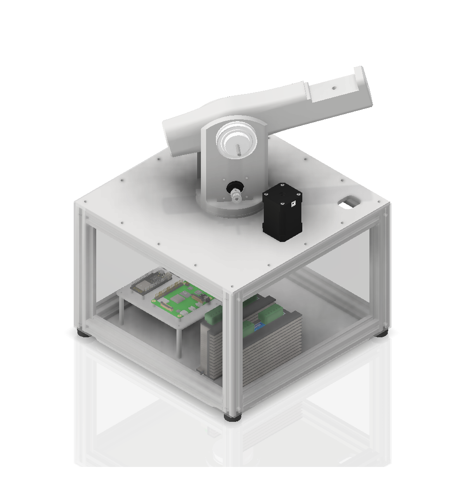
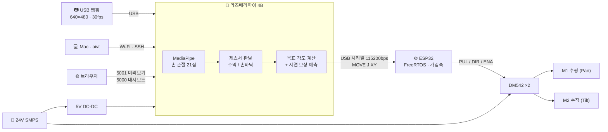

<div align="center">



<br/>


<br/><br/>

# AI Vision Tracker `v3.0.0`

**손 제스처로 조종하는 2축 스텝모터 터렛**

✊ 주먹을 쥐면 손을 따라가고, ✋ 손바닥을 펴면 멈춥니다.

[🌐 웹사이트](https://lsk0522.github.io/AI_vision_tracker/) · [📝 바뀐점](./docs/CHANGELOG.md) · [📖 사용자 가이드](./docs/USER_GUIDE.md)

</div>

---

## 📋 한눈에 보기

하드웨어 : 라즈베리파이 4B, ESP32, 스텝모터 2개 (수평, 수직), DM542 드라이버 2개, 24V SMPS, 5V DC-DC 컨버터, USB 웹캠, 1:5 감속 기어 (16T → 80T)

소프트웨어 (라즈베리파이) : Python, MediaPipe, OpenCV, NumPy, pyserial, v4l2-ctl

소프트웨어 (ESP32) : C++ (Arduino), FreeRTOS, 가감속 제어

소프트웨어 (Mac 관리 도구) : Python, SSH

소프트웨어 (웹 대시보드) : Flask, HTML, CSS, JavaScript

통신 : UART 시리얼 (115200bps), USB, SSH, Wi-Fi

주요 기능 : 손 관절 인식, 제스처 판별 (주먹 = 따라가기, 손바닥 = 정지), 2축 자동 추적, 지연 보상 예측, 카메라 자동 밝기 조절, 자동 캘리브레이션, 조이스틱 수동 조작, 웹 미리보기

---

## 🏗️ 시스템 구성도

전원 : 24V SMPS → DM542 드라이버 2개 (모터 전원), 24V SMPS → 5V DC-DC 컨버터 → 라즈베리파이 4B

영상 : USB 웹캠 → (USB) → 라즈베리파이 4B

제어 : 라즈베리파이 4B → (USB 시리얼 115200bps) → ESP32 → (PUL / DIR / ENA) → DM542 드라이버 2개 → 스텝모터 2개 (수평, 수직)

관리 : Mac → (Wi-Fi, SSH) → 라즈베리파이 4B

화면 : 브라우저 → (Wi-Fi) → 라즈베리파이 4B (미리보기 5001번 포트, 대시보드 5000번 포트)

```text
                       ┌──────────────── 24V SMPS ────────────────┐
                       │                                          │
                       ▼                                          ▼
                5V DC-DC 컨버터                          DM542 드라이버 ×2
                       │                                    ▲          │
                       ▼                                    │          ▼
 USB 웹캠 ──USB──▶ 라즈베리파이 4B ──USB 시리얼──▶ ESP32 ──PUL/DIR/ENA──┘     스텝모터 ×2
                  (MediaPipe 손 인식,  115200bps  (FreeRTOS,                 (수평 Pan,
                   목표 각도 계산)                  가감속 펄스)               수직 Tilt)
                    ▲            ▲
          Wi-Fi·SSH │            │ Wi-Fi·HTTP
                    │            │
           Mac (aivt 관리 도구)   브라우저 (미리보기 · 대시보드)
```



---

## 🧠 동작 원리

```text
카메라 프레임 ──▶ MediaPipe 손바닥 중심 ──▶ "촬영 순간의 모터 위치 + 화면 오차" = 손의 절대 각도
                                                │
                                   지연 보상 예측 (0.18초 앞, 최대 60px)
                                                │
                                   MOVE J XY <M1> <M2>  (새 검출마다 1번) ──▶ ESP32
```

| 단계 | 하는 일 |
|:---|:---|
| **① 손 인식** | MediaPipe Hand Landmarker 가 손 관절 21개를 찾고, 손바닥 중심(관절 0·5·9·13·17 평균)을 구합니다 |
| **② 제스처 판별** | 주먹(FIST) = 따라가기, 손바닥(OPEN) = 정지. 3프레임 연속일 때만 바뀌고, 손이 1초 넘게 사라지면 정지합니다 |
| **③ 각도 계산** | 사진을 찍은 순간의 모터 위치에 화면 오차 × 게인(°/px)을 더해 손의 절대 각도를 구합니다. 같은 오차를 두 번 더하지 않습니다 |
| **④ 지연 보상** | 처리 지연만큼 손이 갈 곳을 예측해 조금 앞을 겨냥합니다 |
| **⑤ 안전 장치** | 손을 0.2초 놓치면 정지, 150px 넘게 튄 검출 무시, 명령 1번 이동량 제한, ESP32 가 재시작되면 추적 정지 |
| **⑥ 모터 구동** | ESP32 가 목표 각도까지 가감속 펄스를 만들고 DM542 가 스텝모터를 돌립니다 (최대 3500Hz, 가속도 25Hz/ms) |
| **⑦ 자동 밝기** | 0.5초마다 밝기를 재서 노출(78~130)과 gain(0~40)을 조절합니다. 번짐을 줄이려고 노출은 최대한 짧게 유지합니다 |

### 제스처 규칙

| 제스처 | 동작 |
|:---:|:---|
| ✊ **주먹** | 터렛이 손을 따라감 |
| ✋ **손바닥 (편 손)** | 그 자리에서 즉시 정지 |
| ✌️ 그 외 애매한 손 모양 | 현재 상태 유지 |
| 손이 1초 이상 안 보임 | 정지 상태로 복귀 (다시 주먹을 쥐어야 출발) |

- 시작할 때는 **정지 상태**입니다. 손을 보여도 주먹을 쥐기 전에는 움직이지 않습니다.
- 손가락 끝이 둘째 마디보다 손목에서 먼지 가까운지로 판별하기 때문에 손 방향(회전)과 무관합니다.

### 예전 `T:x:y` 방식과의 차이

- 예전 방식은 *ESP32 가 명령을 받은 순간의 위치 + 오차* 로 목표를 잡아, 카메라 · 검출 지연 동안 이미 움직인 만큼을 한 번 더 더하게 됩니다 (지나쳤다 돌아오는 원인).
- 새 방식은 프레임을 찍은 순간의 모터 위치를 기준으로 하므로 같은 오차를 두 번 더하지 않습니다. 축마다 알파-베타 필터(위치 · 속도)로 다듬은 뒤 예측하고, 한 번 이동량 제한과 물리 안전 리밋을 거쳐 보냅니다.
- **캘리브레이션**: 모터를 ±1° 움직여 화면이 몇 px 밀리는지 위상상관(phase correlation)으로 재서 `°/px` 게인을 구합니다. 펌웨어 기본 환산값이 실제와 다르면 어떤 필터로도 잘 따라가지 못하므로 **처음 한 번은 꼭** 실행하세요.

> [!NOTE]
> MediaPipe 최신 버전(0.10.3x 이후, 1.x)에서는 `mp.solutions` API 가 삭제되었습니다. `hand_tracker.py` 는 설치된 버전에 맞춰 구버전 API / 신버전 Tasks API(`hand_landmarker.task`)를 자동 선택합니다. MediaPipe 는 **64비트 Raspberry Pi OS** 에서만 설치됩니다.

---

## 🚀 실행 방법

모든 명령은 **Mac 터미널**에서 실행합니다. `aivt` 가 SSH(`ssh pi`)로 라즈베리파이에 접속해 최신 코드를 올리고 실행합니다.

### 처음 한 번

프로젝트 폴더에서 아래를 한 줄씩 실행합니다.

```bash
./scripts/setup_ssh_key.sh
```

```bash
python3 scripts/aivt.py install
```

```bash
source ~/.zshrc
```

```bash
aivt deps
```

```bash
aivt calibrate
```

- `setup_ssh_key.sh` : 비밀번호 없는 SSH + `ssh pi` 별칭 등록 (파이 IP 가 바뀌어도 `scripts/find_pi.py` 로 자동으로 찾음)
- `aivt.py install` : `aivt` 명령 등록 + 더블클릭 실행 파일 `AIVT.command` 생성 (Dock 이나 바탕화면에 두면 클릭 한 번으로 메뉴가 열림)
- `aivt deps` : 라즈베리파이에 손 추적 전용 가상환경(`backend/.venv`)과 필요한 프로그램 설치. 기존 대시보드 환경은 건드리지 않으며 공간이 1.2GB 이상 필요합니다 (Pi 4 는 mediapipe 0.10.18 자동 선택)
- `aivt calibrate` : 모터를 조금 움직여 화면이 몇 px 밀리는지 재고 게인을 저장합니다. 무늬가 있는 배경을 향하게 두고, 화면에 움직이는 것이 없게 하세요.

### 손 추적

```bash
aivt run
```

```bash
aivt preview
```

- `aivt run` : 손 추적 시작. 끄려면 `Ctrl + C`
- `aivt preview` : 브라우저로 미리보기 (`http://<파이주소>:5001/`)
  - 주황 점 21개 = 손 관절, 초록 원 = 손바닥 중심, 흰 십자 = 화면 가운데
  - 현재 상태(`FOLLOW` / `STOP`)와 인식된 모양(`[FIST]` / `[OPEN]`)도 표시됩니다.

### 조이스틱 수동 조작 (웹 대시보드)

```bash
aivt dashboard
```

```bash
aivt web
```

- 브라우저에서 `http://<파이주소>:5000/` 의 조이스틱으로 조작합니다.
- 손 추적과 대시보드는 카메라와 ESP32 를 같이 쓰므로 **동시에 켤 수 없습니다.** 하나를 켜면 `aivt` 가 다른 하나를 자동으로 끕니다.

### 그 밖의 명령

| 명령 | 하는 일 |
|:---|:---|
| `aivt` | 번호 메뉴 (`AIVT.command` 더블클릭과 같음) |
| `aivt status` | 파이 연결 · Mac/파이 코드 버전 · 실행 중인 프로그램 · mediapipe 확인 |
| `aivt sync` | 코드 업데이트만 |
| `aivt stop` | 파이에서 실행 중인 프로그램 정지 |
| `aivt watch` | Mac 에서 파일을 저장할 때마다 자동 업데이트 |
| `aivt diff <파일>` | Mac ↔ 파이 파일 비교 |
| `aivt rollback` | 마지막 업데이트 되돌리기 |
| `aivt clean` | 라즈베리파이 공간 정리 (지우기 전에 목록을 보여 줌). 캐시는 바로, 코드/자료는 Mac `~/AIVT_pi_backup/` 으로 백업 후 삭제 |
| `aivt ssh` | 라즈베리파이 터미널 접속 |

> [!IMPORTANT]
> - Mac 폴더가 기준입니다. 실행할 때마다 파이 코드와 해시로 비교해 **바뀐 파일만** 올립니다.
> - 동기화 대상은 `backend/`, `scripts/`, `firmware/` 뿐입니다. 사진 · 학습 데이터 · 가상환경 · 캘리브레이션 값은 건드리지 않으며, 파이에만 있는 파일도 지우지 않습니다.
> - 파이에서 직접 수정한 파일은 덮어쓰기 전에 물어봅니다 (`y` 덮어쓰기 / `s` 건너뛰기 / `d` 차이 보기).
> - 덮어쓴 파일은 파이의 `~/.aivt/backups/` 에 최근 10번까지 백업됩니다.

---

## ⚙️ `aivt run` 옵션

옵션 없이 `aivt run` 만 쳐도 아래 기본값으로 실행됩니다. 바꾸고 싶은 값만 뒤에 붙이세요. 예: `aivt run --gain 0.9`

| 옵션 | 기본값 | 의미 |
|:---|:---:|:---|
| `--msl` | `3500` | ESP32 최대 속도 (Hz) |
| `--acc` | `250` | 가속도 (Hz/ms × 10, `250` = 25Hz/ms) |
| `--gain` | `1.0` | 모터 반응 배율. 지나쳤다 돌아오면 ↓, 느리면 ↑ |
| `--lead` | `0.18` | 지연 보상 예측 시간 (초) |
| `--max-lead-px` | `60` | 예측으로 앞서 보내는 최대량 (px) |
| `--lost-stop` | `0.2` | 손을 이 시간(초) 못 찾으면 정지 |
| `--jump-px` | `150` | 한 번에 이보다 크게 튄 검출은 무시 (px) |
| `--max-step` | 화면 200px 분량 | 명령 1번에 움직이는 최대 각도 (펌웨어 °) |
| `--deadzone` | `6` | 화면 가운데에서 이 범위(px) 안이면 움직이지 않음 |
| `--gesture` | `fist` | `any` 로 두면 제스처 없이 손만 보이면 따라감 |
| `--exposure` / `--cam-gain` | 자동 밝기 | 값을 주면 그 값으로 고정 (노출은 0.1ms 단위, 예: `130` = 13ms). 하나만 주면 다른 쪽은 `130` / `30`. `--exposure 0` = 카메라 자동 노출, `--cam-gain -1` = gain 그대로 |
| `--bright-target` | `120` | 자동 밝기 목표 (±20 안이면 그대로 둠) |
| `--ae-exp-max` / `--ae-gain-max` | `130` / `40` | 자동 밝기의 노출 · gain 상한 |
| `--proc-width` | `320` | MediaPipe 입력 폭. 작을수록 빠르지만 덜 정확 |
| `--preview-port` | `5001` | 미리보기 포트 (`0` = 끄기) |
| `--no-motor` | | 모터 없이 인식 · 미리보기만 |

**실측 튜닝 결과 (2026-11-20)** : 노출 130 / gain 30, 예측 0.18초 / 60px, 가속도 25Hz/ms 조합이 가장 부드러웠고 탈조가 없었습니다. `--lost-stop` 이나 `--jump-px` 를 늘리면 오히려 더 끊겼습니다.

| 시험 | 설정 | 결과 |
|:---:|:---|:---|
| A | `--acc 200 --exposure 100 --cam-gain 20 --lead 0.18 --max-lead-px 60` | 좋음 |
| B | A + `--lost-stop 0.35` | 오히려 더 끊김 |
| C | `--exposure 130 --cam-gain 30` (lead 는 기본값) | A 와 비슷 |
| D | A + C (노출 130 / gain 30) | 가장 좋음 → 이걸 기준으로 가속도만 250 으로 올림 |
| E | D + `--jump-px 220` | D 보다 더 끊김 |
| — | `--acc 250` | 탈조 없음 |

남은 문제: 가끔 끊김 (`docs/HANDOFF.md` 참고).

### 자동 밝기 (`--exposure` · `--cam-gain` 을 안 주면 켜짐)

- 시작값은 시험 D 의 노출 130 / gain 30. 0.5초마다 밝기를 재서 `v4l2-ctl` 로 조금씩 바꿉니다.
- 노출은 손 번짐을 막기 위해 최대한 짧게 둡니다.
  - 너무 밝으면 : 노출을 78까지 먼저 줄이고, 그래도 밝으면 gain 을 0까지 내림
  - 너무 어두우면 : gain 을 먼저 40까지 올리고, 그래도 어두우면 노출을 130까지만 늘림
- 밝기 기준 : 손이 검출되면 손바닥 영역 평균 밝기, 없으면 화면 전체 평균과 하얗게 날아간(250 이상) 픽셀 비율. 손을 놓친 뒤 2초 동안은 바꾸지 않습니다.
- 깜빡임 방지 : 목표 ±20 안이면 안 바꿈. 한 번에 노출 ×1.12(멀면 ×1.25), gain ±2(멀면 ±4)만 바꿈.
- 상태줄 끝에 `exp 104 gain 30 auto(hand 125)` 처럼 현재 노출 · gain, 기준(hand / frame / hold), 측정 밝기가 표시됩니다. 고정이면 `exp 130 gain 30 fixed`.
- 종료할 때 카메라 설정을 원래대로 되돌립니다.

---

## 🔧 하드웨어

| 부품 | 모델 / 사양 |
|:---|:---|
| 메인 컨트롤러 | Raspberry Pi 4 Model B |
| 모터 컨트롤러 | ESP32 (Lolin D32, FreeRTOS 듀얼코어) |
| 모터 드라이버 | DM542 × 2 |
| 모터 | 스텝모터 × 2 (M1 수평 Pan, M2 수직 Tilt) |
| 감속 기어 | 모터 16T → 출력 80T (1 : 5) |
| 전원 | 24V SMPS (모터), 5V DC-DC 컨버터 (라즈베리파이) |
| 카메라 | USB 웹캠 (640×480, 30fps, MJPG) |

### ESP32 ↔ DM542 배선 (펌웨어 `esp32_firmware.ino` 기준)

| 축 | ENA | DIR | PUL |
|:---|:---:|:---:|:---:|
| M1 (수평 Pan) | GPIO 13 | GPIO 14 | GPIO 16 |
| M2 (수직 Tilt) | GPIO 22 | GPIO 21 | GPIO 23 |

> 모터 드라이버 전원은 반드시 SMPS 를 쓰고, ESP32 전원으로 모터를 돌리지 마세요.

### 작동 범위 (안전 리밋)

- M1 (수평) : ±180°
- M2 (수직) : +50° ~ -40°
- 카메라가 -25° 아래를 볼 때는 기둥과 부딪히지 않도록 M1 범위가 자동으로 줄어듭니다.

### ESP32 펌웨어 (v2.0.7)

| 코어 | 태스크 | 하는 일 |
|:---:|:---:|:---|
| Core 0 | `serialTask` | 시리얼 명령 수신 (`MOVE J`, `S`, `CFG` 등) |
| Core 1 | `motorTask` | 가감속 계산 + DM542 펄스 출력 |

- 실행 중 설정 변경 : `CFG:MSL:<Hz>` (최대 속도), `CFG:ACC:<Hz/ms × 10>` (가속도)
- 5초 동안 명령이 없으면 모터 전류를 자동 해제합니다 (Watchdog).

---

## 📂 폴더 구조

```text
📦 AI_vision_tracker
 ┣ 📂 backend      라즈베리파이 코드 (hand_tracker.py 손 추적, main.py 웹 대시보드)
 ┣ 📂 firmware     ESP32 펌웨어 (esp32_firmware.ino)
 ┣ 📂 scripts      Mac 관리 도구 (aivt.py) 와 설치 · 실행 스크립트
 ┣ 📂 website      소개 웹사이트 (React + Three.js, GitHub Pages)
 ┣ 📂 hardware     터렛 3D 모델
 ┣ 📂 tools/sim    하드웨어 없이 손 추적 제어를 검증하는 시뮬레이터 (가짜 ESP32 + 가짜 카메라)
 ┣ 📂 raspi_main   라즈베리파이 옛 평면 구조 사본
 ┣ 📂 docs         문서 (CHANGELOG, USER_GUIDE, HANDOFF, 지난 버전 README)
 ┣ 📂 archive      지난 버전 코드 백업
 ┗ 📜 CLAUDE.md    Claude Code 용 프로젝트 안내
```

> [!TIP]
> Claude Code 로 이어서 작업할 때는 `CLAUDE.md`(프로젝트 규칙 · 구조)와 `docs/HANDOFF.md`(현재 상황 · 다음 할 일)를 참고하세요.

---

## 📝 바뀐점

지난 버전 기록은 지우지 않고 남겨 둡니다. 웹사이트의 **바뀐점** 탭에서도 버전별로 볼 수 있습니다.

| 버전 | 날짜 | 핵심 내용 |
|:---|:---:|:---|
| **v3.0.0** | 2026-11-20 | MediaPipe 손 제스처 추적 전용 실행기, Mac 관리 도구 `aivt`, 지연 보상 예측, 카메라 자동 밝기 |
| v2.1.0 | 2026-07-16 | 폴더 구조 재조정, 웹 대시보드 YOLO → MediaPipe 검출기 교체 |
| v2.0.0 | 2026-07-11 | 패키지 구조 재정비, 복귀 보장 리밋 |
| v1.5.0 | 2026-07-06 | 웹 프론트엔드 전면 개편 (다크 모드, 3D 시뮬레이터) |
| v1.4.0 | 2026-07-03 | 물리 각도 실측, 충돌 방지 안전 구역, 자동 감속 제동 |
| v1.3.0 | 2026-07-03 | 라즈베리파이 전용 실행 환경 |
| v1.2.0 | 2026-07-02 | Apple 스타일 UI, 펌웨어 버전 검사 |
| v1.1.0 | 2026-06-30 | 갤러리 삭제, Arduino 폴백 |
| v1.0.0 | 2026-06-29 | 첫 릴리즈 (OpenCV CSRT 물체 추적) |

- 자세한 내용 : [docs/CHANGELOG.md](./docs/CHANGELOG.md)
- v2.1.0 까지의 README 원본 (CSRT · YOLO 물체 추적 버전) : [docs/versions/README_v2.1.0.md](./docs/versions/README_v2.1.0.md)

---

<div align="center">
  <p><i>본 프로젝트는 서울로봇고등학교 졸업작품의 일환으로 제작되었습니다.</i></p>
  <p>Made with ❤️ by <b>LSK0522</b></p>
</div>
